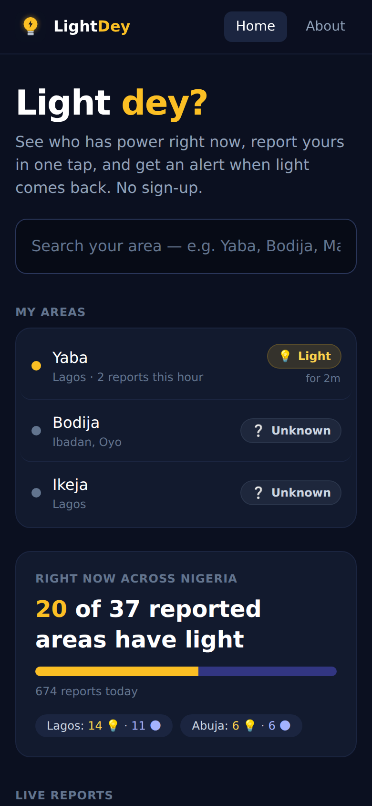
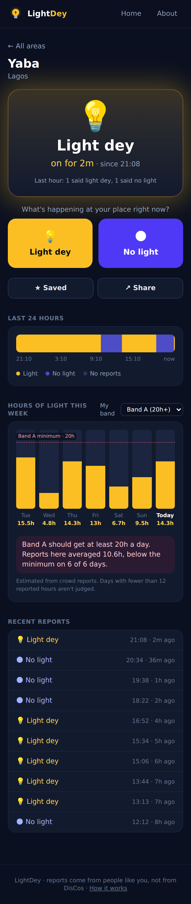

# LightDey 💡

**Is there light in your area? Crowdsourced, real-time electricity supply for Nigerian neighbourhoods.**


Anyone can tap **Light dey** or **No light** for their area. No sign-up. LightDey turns those reports into:

- **a live status**: "No light, off for 6h 20m", with how many people reported in the last hour
- **a 24-hour timeline and hours of supply per day**
- **a band check**: tariff bands promise a minimum daily supply (Band A 20h, B 16h, C 12h, D 8h, E 4h under NERC's Service-Based Tariff). Pick your band and see how your area's reported supply compares.
- **"Light is back" alerts**: push notifications when neighbours report that power has returned

It's an installable web app (PWA). It opens like an app from the home screen, works on cheap Android phones, and every area has a link that shows its live status when shared on WhatsApp or X.

<!-- Replace with your real URL once deployed:
**Live:** https://lightdey-xxxx.onrender.com
-->

| Home | Area page (sample data) |
|---|---|
|  |  |

## How the numbers work

Reports are noisy: people disagree, report late, or stop reporting at night. The engine ([`power/engine.py`](backend/power/engine.py)) handles this simply and transparently:

1. Time is split into **10-minute buckets**. A bucket with reports takes the **majority** state; a tie keeps the previous state.
2. A state **carries forward** until someone reports a change, but for at most **4 hours** after the last report. After that the app says "No recent reports" rather than guessing.
3. **Hours of supply** per Nigerian day come from that timeline. The band check only judges days with at least 12 reported hours, and it says clearly that these are crowd estimates, not meter readings.
4. "Since 21:08" uses the **first report** that started the current state, not the bucket boundary.

The engine is made of pure functions over `(time, state)` pairs, with focused unit tests for each rule.

## Built to be trusted and hard to spam

- **Anonymous:** no accounts, names, phone numbers or locations. Each browser gets a random ID. The server stores only salted hashes of it and of the IP address.
- **Rate limits:** re-reporting the same area within 10 minutes *corrects* your previous report instead of adding a new one. Each device can report at most 5 areas an hour. Each network is capped at 40 reports an hour, and each device can add 3 areas a day.
- **No fake data in production:** starter areas are names only. The report simulator used for screenshots refuses to run unless `DEBUG=True`.

## Tech

| Layer | Tech |
|---|---|
| Backend | Django 5.2, Django REST Framework, PostgreSQL |
| Push | Web Push with VAPID (`pywebpush`), sent after the database commit on a background thread; expired subscriptions are cleaned up |
| Frontend | React 18, React Router, Vite, Tailwind CSS v4 |
| PWA | Web app manifest, service worker (offline shell, network-first pages, never-cached API), install prompt |
| Sharing | Server-rendered Open Graph tags per area, so link previews show the live status |
| Testing | pytest (38 tests, including real VAPID signing and encryption against a local push server), Vitest |
| DevOps | GitHub Actions on PostgreSQL, Docker Compose, Render + Neon |

## API

| Method | Endpoint | Description |
|---|---|---|
| GET | `/api/overview/` | Totals, per-city counts, live feed |
| GET | `/api/areas/?q=&city=&slugs=` | Search areas (recently reported first) |
| POST | `/api/areas/` | Add an area (`name`, `city`, `state`) |
| GET | `/api/areas/<slug>/?band=A&days=7` | Status, 24h timeline, daily hours, band check, recent reports |
| POST | `/api/areas/<slug>/reports/` | Report `{"state": "on" \| "off"}` (needs an `X-Device-Id` header) |
| POST / DELETE | `/api/areas/<slug>/push/` | Subscribe to, or unsubscribe from, "light is back" alerts |
| GET | `/api/push/config/` | Whether push is enabled, plus the public VAPID key |

## Run it locally

```bash
cd backend
python -m venv venv
source venv/Scripts/activate      # macOS/Linux: source venv/bin/activate
pip install -r requirements.txt
python manage.py migrate
python manage.py seed_areas
python manage.py simulate_reports  # optional: a week of fake reports, local only
python manage.py runserver
```

```bash
cd frontend
npm install
npm run dev                        # http://localhost:5173
```

To test notifications, generate keys with `python manage.py generate_vapid_keys`, set them as environment variables, then run a production build (`npm run build`) served by Django on http://localhost:8000. The service worker is only registered in production builds.

Tests: `cd backend && pytest` and `cd frontend && npm test`.

## Deploy (Render + Neon, free)

1. Create a Neon project and copy its connection string.
2. Generate push keys: `python manage.py generate_vapid_keys`.
3. In Render, choose **New → Blueprint** and pick this repo. Fill in `DATABASE_URL`, `VAPID_PUBLIC_KEY`, `VAPID_PRIVATE_KEY` and `VAPID_SUBJECT` (e.g. `mailto:you@example.com`).

No Redis or worker is needed. [`start.sh`](start.sh) migrates, adds starter area names, and starts gunicorn.

## Launch plan

A crowdsourced app is only as good as its first 100 reporters:

1. **Start small and dense.** Pick one place you know (e.g. Ile-Ife around OAU) and get 20–30 people reporting there before going wider. One busy area beats 100 empty ones.
2. **Share the area link, not the home page.** "No light for Mayfair for 9 hours" with a live preview gets clicks in WhatsApp groups.
3. **Post the weekly numbers.** "Band A areas in Lagos averaged 11h of light last week" is the kind of post that spreads on Nigerian Twitter/X.
4. **Watch the data.** Track which areas are active and when people report, then improve based on that.

## Roadmap

- [ ] Map view (area coordinates + Leaflet)
- [ ] Weekly shareable "power report card" image per area
- [ ] Feeder / DisCo tagging for more precise band checks
- [ ] Reporter reputation (weight consistent reporters higher)
- [ ] Public read-only API and open data export for journalists and researchers
- [ ] SMS / USSD reporting for feature phones

## Author

**Toheeb Olatunde**, Computer Science, Obafemi Awolowo University
GitHub: [@Horrly](https://github.com/Horrly)
